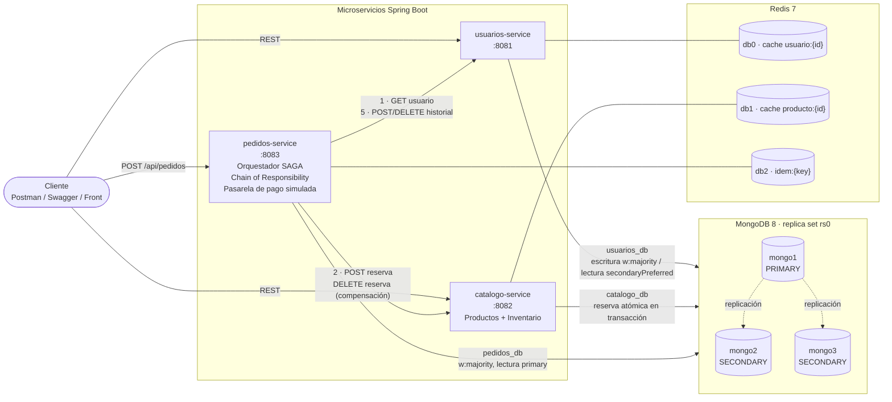
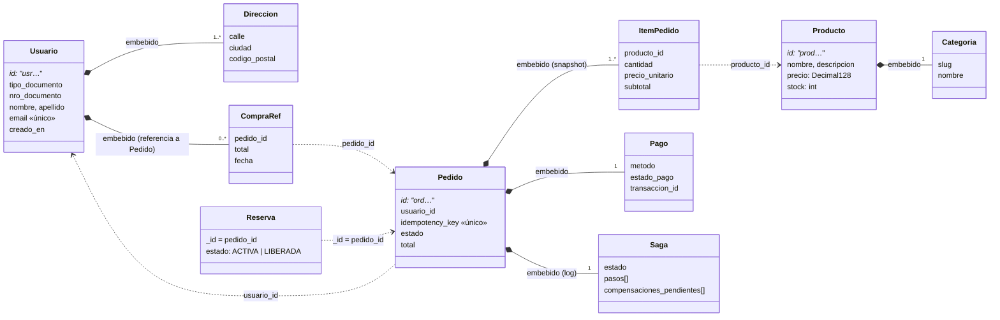
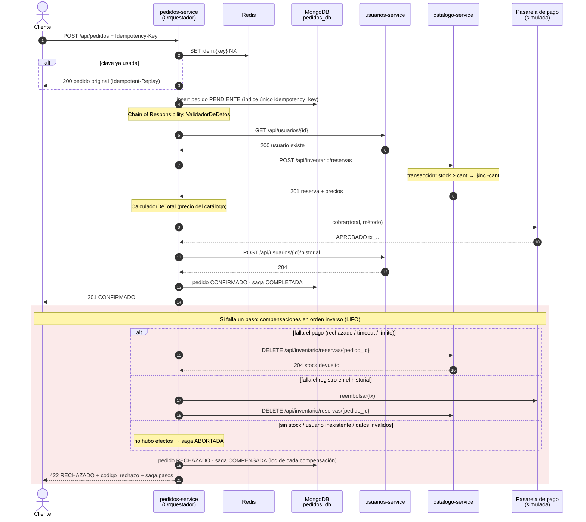
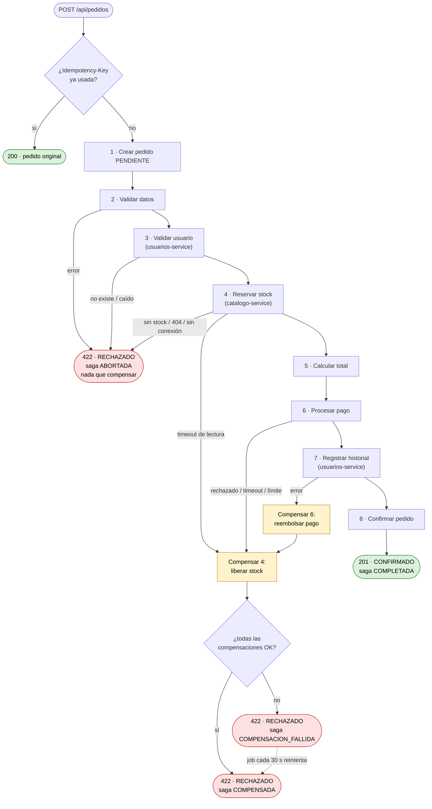
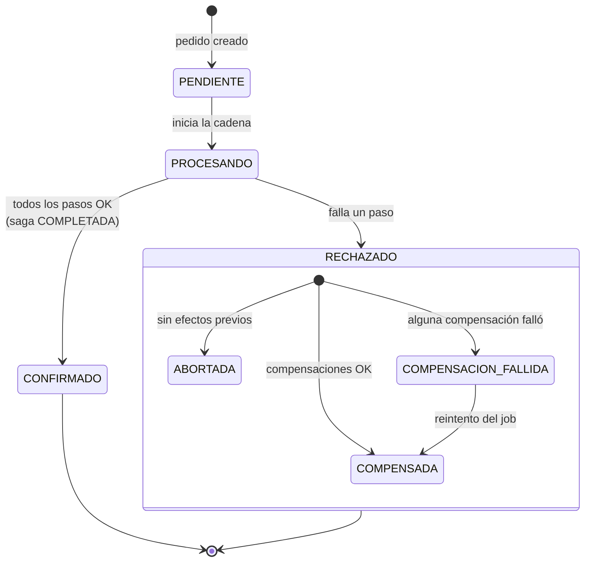
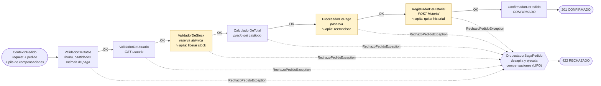
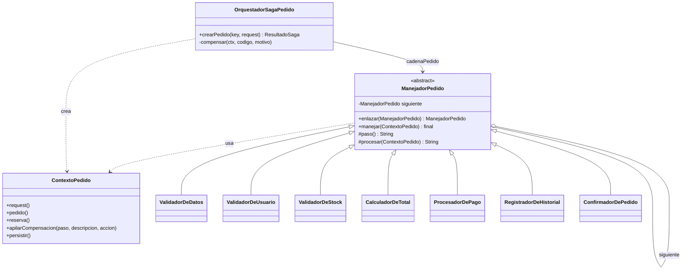

# ShopExpress — Microservicios con bases de datos NoSQL políglotas

Tarea 2 (2026) — Diseño e implementación de un sistema de microservicios para **ShopExpress**, una plataforma ficticia de comercio electrónico.

Tres microservicios **Spring Boot 4.1 / Java 21**, persistencia **MongoDB 8 (replica set de 3 nodos) + Redis 7**, patrones **SAGA orquestada** y **Chain of Responsibility**, desplegados con **Docker Compose**.

| Servicio | Puerto | Responsabilidad | Swagger UI |
|---|---|---|---|
| `usuarios-service` | 8081 | Perfiles, direcciones e historial de compras | http://localhost:8081/swagger-ui.html |
| `catalogo-service` | 8082 | Productos, categorías, precios y stock (inventario) | http://localhost:8082/swagger-ui.html |
| `pedidos-service` | 8083 | Pedidos y pagos — **orquestador de la SAGA** | http://localhost:8083/swagger-ui.html |

---

## Índice

1. [Inicio rápido](#1-inicio-rápido)
2. [Diagrama de arquitectura](#2-diagrama-de-arquitectura)
3. [Justificación del diseño](#3-justificación-del-diseño)
   - [3.1 Consistencia y lectura/escritura (CAP)](#31-requerimientos-de-consistencia-y-lecturaescritura-cap)
   - [3.2 Modelado de datos NoSQL](#32-modelado-de-datos-nosql)
   - [3.3 Patrón SAGA (orquestación)](#33-patrón-saga-orquestación)
   - [3.4 Patrón Chain of Responsibility](#34-patrón-chain-of-responsibility)
   - [3.5 Patrones avanzados y privacidad](#35-patrones-avanzados-y-privacidad-opcional)
   - [3.6 Despliegue](#36-tecnologías-de-despliegue)
4. [Diagrama de flujo del patrón SAGA](#4-diagrama-de-flujo-del-patrón-saga)
5. [Diagrama del patrón Chain of Responsibility](#5-diagrama-del-patrón-chain-of-responsibility)
6. [Endpoints](#6-endpoints)
7. [Comandos: construir, levantar y probar](#7-comandos-construir-levantar-y-probar)
8. [Estructura del repositorio](#8-estructura-del-repositorio)
9. [Limitaciones y trabajo futuro](#9-limitaciones-y-trabajo-futuro)

---

## 1. Inicio rápido

Requisitos: **Docker Desktop** (Docker Engine + Compose v2). No hace falta tener Java ni Maven: las imágenes se compilan dentro de Docker.

```bash
docker compose up -d --build      # construye y levanta los 7 contenedores
docker compose ps                 # esperar a que todos digan (healthy)
./scripts/prueba-saga.sh          # recorre todos los escenarios de la SAGA
```

Luego, cualquiera de los Swagger UI de la tabla de arriba, o la colección Postman de [`postman/`](postman/ShopExpress.postman_collection.json).

---

## 2. Diagrama de arquitectura



- **Database-per-service**: cada servicio tiene su propia base lógica en MongoDB (`usuarios_db`, `catalogo_db`, `pedidos_db`) y su propia base en Redis (`0`, `1`, `2`). Ningún servicio lee la base de otro: se comunican solo por REST.
- La comunicación de la SAGA es **REST síncrona con timeouts** (conexión 2 s, lectura 5 s).

---

## 3. Justificación del diseño

### 3.1 Requerimientos de consistencia y lectura/escritura (CAP)

El enunciado pide dos comportamientos opuestos según la operación, por eso cada servicio usa **dos configuraciones de MongoDB** ([`MongoConfig`](usuarios-service/src/main/java/com/shopexpress/usuarios/config/MongoConfig.java)):

| Operación | Prioridad | Cómo se logra |
|---|---|---|
| `GET /api/usuarios/{id}`, `GET /api/productos/{id}` | **AP** — rapidez, escalabilidad y disponibilidad; se acepta **consistencia eventual** | 1) **Redis** cache-aside (TTL 60 s usuarios / 30 s productos). 2) En cache-miss, MongoDB con `readPreference=secondaryPreferred` (reparte la carga en los secundarios y sigue respondiendo si cae el primario). 3) Si Redis no responde, se sigue contra Mongo (*fail-soft*). |
| `POST /api/pedidos`, reservas de stock, pagos | **CP** — consistencia sobre velocidad | `writeConcern=majority`, `readConcern=majority`, lecturas en el **primario**, **update atómico condicional** de stock y **transacciones multi-documento** en el replica set. |

> El `GET` de un producto puede mostrar un stock con algunos segundos de atraso. Es aceptable porque **la decisión de venta nunca usa ese dato**: la toma el update atómico en el primario dentro de la reserva.

**Sin sobreventa.** La reserva descuenta stock con una única operación atómica condicional sobre el documento del producto ([`InventarioService`](catalogo-service/src/main/java/com/shopexpress/catalogo/servicio/InventarioService.java)):

```js
db.productos.findOneAndUpdate(
  { _id: "prod_001", stock: { $gte: 2 } },     // solo si alcanza
  { $inc: { stock: -2 } }
)
```

MongoDB garantiza atomicidad por documento: dos pedidos concurrentes no pueden dejar el stock negativo. Si el pedido tiene varios productos, todos se reservan **dentro de una transacción** (o todos o ninguno). Cuando dos transacciones chocan sobre el mismo producto (`WriteConflict`, etiqueta `TransientTransactionError`) se reintenta con backoff aleatorio. Verificado: 20 reservas concurrentes con stock 1 → 1 éxito; 60 con stock 5 → 5 éxitos; stock final 0 en ambos casos.

**Pedido único (idempotencia).** `POST /api/pedidos` exige el header `Idempotency-Key`:

1. **Redis**: `SET idem:{key} {pedido_id} NX EX 86400` — barrera rápida.
2. **MongoDB**: índice **único** en `pedidos.idempotency_key` — barrera definitiva (si Redis no está o perdió la clave).

Repetir la petición devuelve el **mismo pedido** (`200` + `Idempotent-Replay: true`) sin volver a reservar ni cobrar. Además, la reserva de stock usa el `pedido_id` como `_id`, por lo que un pedido no puede reservar dos veces.

### 3.2 Modelado de datos (NoSQL)

#### Tecnologías elegidas

| Base | Tipo | Asignación | Por qué |
|---|---|---|---|
| **MongoDB 8** | Documental | Fuente de verdad de los 3 servicios (una base lógica por servicio) | Los agregados del dominio (usuario con direcciones, pedido con ítems y pago) son **documentos JSON** naturales, como los del anexo del enunciado. Ofrece **atomicidad por documento** (clave para el stock), **transacciones multi-documento**, **replica set** con elección automática de primario y *write/read concerns* configurables por operación: permite ser CP en escrituras y AP en lecturas con la misma tecnología. |
| **Redis 7** | Clave-valor en memoria | Usuarios y Catálogo: **caché de lectura** · Pedidos: **claves de idempotencia** | Latencia sub-milisegundo para el lado de lectura (AP), TTL nativo para acotar la "ventana" de consistencia eventual, y `SET NX` atómico para la idempotencia. |

#### Embebido vs. referencia

| Relación | Patrón | Motivo |
|---|---|---|
| Usuario → direcciones | **Embebido** | Pocas por usuario y siempre se leen con él (una sola lectura). |
| Usuario → historial de compras | **Referencia** (`pedido_id` + total + fecha) | Crece con el tiempo y su detalle pertenece a otro microservicio. |
| Producto → categoría | **Embebido** (`{slug, nombre}`) | Cambia poco; evita un "join" en la lectura más frecuente. |
| Producto → stock | **Mismo documento** | Permite la reserva atómica sin locks distribuidos. |
| Pedido → ítems | **Embebido** con *snapshot* de precio | El precio cobrado no debe cambiar si luego cambia el catálogo. |
| Pedido → pago | **Embebido** | Ciclo de vida 1:1 con el pedido. |
| Pedido → usuario / productos | **Referencia** (ids) | Pertenecen a otros microservicios. |
| Reserva → pedido | `_id` = `pedido_id` | Idempotencia de la reserva y compensación exacta. |



Ejemplo de pedido guardado en MongoDB (igual estructura que el anexo del enunciado, más el log de la SAGA):

```json
{
  "pedido_id": "ord_39f8fc25546f",
  "usuario_id": "usr_f081cf742bc3",
  "estado": "CONFIRMADO",
  "items": [
    { "producto_id": "prod_430cac33f7a5", "nombre": "Teclado", "cantidad": 2, "precio_unitario": 25.50, "subtotal": 51.00 }
  ],
  "total": 51.00,
  "pago": { "metodo": "TARJETA_CREDITO", "estado_pago": "APROBADO", "transaccion_id": "tx_e9c0d1514b" },
  "saga": {
    "estado": "COMPLETADA",
    "pasos": [
      { "orden": 1, "paso": "CREAR_PEDIDO",   "tipo": "ACCION", "resultado": "OK", "detalle": "Pedido registrado en estado PENDIENTE" },
      { "orden": 4, "paso": "RESERVAR_STOCK", "tipo": "ACCION", "resultado": "OK", "detalle": "2 unidad(es) reservadas en 1 producto(s)" },
      { "orden": 8, "paso": "CONFIRMAR_PEDIDO", "tipo": "ACCION", "resultado": "OK", "detalle": "Pedido confirmado" }
    ]
  }
}
```

Convenciones: campos en `snake_case` tanto en la API como en MongoDB (igual que los JSON del enunciado); montos como `Decimal128` (sin errores de punto flotante); ids generados por el servidor con prefijo (`usr_`, `prod_`, `ord_`).

### 3.3 Patrón SAGA (orquestación)

Crear y pagar un pedido es una **transacción distribuida** entre tres servicios, cada uno con su propia base: no existe un `COMMIT` global. Se implementa una **SAGA orquestada**: `pedidos-service` actúa como **orquestador central** ([`OrquestadorSagaPedido`](pedidos-service/src/main/java/com/shopexpress/pedidos/saga/OrquestadorSagaPedido.java)) que ejecuta los pasos en orden y, ante un fallo, ejecuta las **transacciones de compensación** en **orden inverso** (LIFO).

Se eligió orquestación (y no coreografía) porque el flujo es secuencial y con un dueño claro, la lógica de compensación queda en un solo lugar y el estado completo de cada transacción es consultable (`GET /api/pedidos/{id}` devuelve `saga.pasos`).

| # | Paso (transacción local) | Servicio | Compensación |
|---|---|---|---|
| 1 | Crear pedido `PENDIENTE` (idempotente) | Pedidos | — (queda `RECHAZADO` con el motivo) |
| 2 | Validar datos del pedido | Pedidos | — (sin efectos) |
| 3 | Validar que el usuario exista | Usuarios | — (solo lectura) |
| 4 | **Reservar stock** (atómico) | Catálogo | **Liberar stock** `DELETE /api/inventario/reservas/{pedido_id}` |
| 5 | Calcular total con precios del catálogo | Pedidos | — |
| 6 | **Cobrar el pago** | Pedidos (pasarela simulada) | **Reembolsar** el pago |
| 7 | **Registrar en el historial** del usuario | Usuarios | **Quitar del historial** `DELETE /api/usuarios/{id}/historial/{pedido_id}` |
| 8 | Confirmar pedido `CONFIRMADO` | Pedidos | — |

Estados de la SAGA: `EN_CURSO` → `COMPLETADA` · `ABORTADA` (falló antes de producir efectos, no hay nada que compensar) · `COMPENSADA` (se revirtieron los efectos) · `COMPENSACION_FALLIDA` (una compensación no pudo ejecutarse todavía).

Decisiones para que la SAGA sea robusta:

- **Todas las compensaciones son idempotentes** (liberar una reserva ya liberada o inexistente, o quitar algo que no está, no hace nada), por lo que se pueden reintentar sin riesgo.
- **Resultado desconocido**: la compensación de un paso se registra *antes* de invocarlo. Si la llamada da *timeout* de lectura no sabemos si el otro servicio la procesó, y la compensación cubre ese caso. Solo se descarta cuando el resultado es un rechazo seguro: `409` sin stock, `404`, o fallo de **conexión** (la petición nunca llegó).
- **Convergencia**: si una compensación falla (p. ej. el catálogo está caído), el pedido queda `COMPENSACION_FALLIDA` y un job ([`ReintentadorCompensaciones`](pedidos-service/src/main/java/com/shopexpress/pedidos/saga/ReintentadorCompensaciones.java)) la reintenta cada 30 s hasta que el pedido queda `COMPENSADA`.
- **Trazabilidad**: cada paso y cada compensación se persisten en `pedido.saga.pasos` con `writeConcern=majority`.
- **Pago simulado con fallos provocables** (no hay proveedor real): `TARJETA_RECHAZADA` → rechazado, `TARJETA_TIMEOUT` → la pasarela no responde, total > 10.000 → límite de crédito. El header `X-Simular-Fallo: HISTORIAL` hace fallar el último paso para mostrar la compensación en cascada.

El flujo completo está en la [sección 4](#4-diagrama-de-flujo-del-patrón-saga).

### 3.4 Patrón Chain of Responsibility

La lógica de negocio dentro de `pedidos-service` es secuencial, así que se estructura como una **cadena de manejadores** ([`cadena/`](pedidos-service/src/main/java/com/shopexpress/pedidos/cadena)). Cada manejador hace **una sola cosa** y, si sale bien, delega en el siguiente; si falla, lanza `RechazoPedidoException` y la cadena se corta.

```
ValidadorDeDatos → ValidadorDeUsuario → ValidadorDeStock → CalculadorDeTotal
                 → ProcesadorDePago → RegistradorDeHistorial → ConfirmadorDePedido
```

- La clase base [`ManejadorPedido`](pedidos-service/src/main/java/com/shopexpress/pedidos/cadena/ManejadorPedido.java) implementa el método plantilla `manejar()`: ejecuta el eslabón, registra el resultado en el log de la SAGA, persiste y llama al siguiente.
- Los manejadores son *singletons* sin estado; todo lo propio del pedido viaja en un `ContextoPedido`, que incluye la **pila de compensaciones**.
- La cadena se arma en un único lugar ([`CadenaConfig`](pedidos-service/src/main/java/com/shopexpress/pedidos/cadena/CadenaConfig.java)): agregar, quitar o reordenar validaciones no toca a los demás eslabones.
- **Relación con la SAGA**: la cadena define *qué* se hace y en *qué orden*; el orquestador gestiona el *estado*, la persistencia del log y las *compensaciones*. Los eslabones con efectos en otros servicios (`ValidadorDeStock`, `ProcesadorDePago`, `RegistradorDeHistorial`) son los pasos de la SAGA y apilan su compensación.

El diagrama está en la [sección 5](#5-diagrama-del-patrón-chain-of-responsibility).

### 3.5 Patrones avanzados y privacidad (opcional)

**Seudonimización — implementada.** `GET /api/usuarios/exportar?formato=json|csv` ([`Seudonimizador`](usuarios-service/src/main/java/com/shopexpress/usuarios/servicio/Seudonimizador.java)) exporta datos para analítica sin datos personales:

| Dato | Técnica |
|---|---|
| `id`, `email` | **HMAC-SHA256** con sal secreta (`EXPORT_SALT`): permite cruzar exportaciones, pero no reidentificar sin la sal |
| `nro_documento` | **Enmascarado** (`*****678`) |
| `nombre`, `apellido` | **Iniciales** (`J.P.`) |
| dirección | **Generalización**: solo ciudad y código postal |
| historial | **Agregado**: cantidad de compras y total |

Mejoras posibles: **cifrado a nivel de campo** de documento y email con *MongoDB Client-Side Field Level Encryption / Queryable Encryption* (la base nunca ve el dato en claro), y separar la sal/claves en un gestor de secretos.

**CQRS — aplicado en forma parcial y extensible.** El lado de lectura ya está separado del de escritura (Redis + secundarios vs. primario con `majority`). El siguiente paso sería un **modelo de lectura propio** (por ejemplo, un documento "vista de producto" o un catálogo denormalizado para búsquedas) actualizado por eventos, en lugar de cachear el mismo documento.

**Event Sourcing — propuesta.** El log `saga.pasos` ya es una secuencia de eventos de cada pedido. Llevándolo a Event Sourcing, el pedido se guardaría como una colección *append-only* de eventos (`PedidoCreado`, `StockReservado`, `PagoAprobado`, `PagoReembolsado`…) y su estado se reconstruiría reproduciéndolos. Junto con un **Transactional Outbox** y un broker (Kafka/RabbitMQ), esos eventos alimentarían los modelos de lectura de CQRS y permitirían pasar a comunicación asíncrona.

### 3.6 Tecnologías de despliegue

- **Docker Compose** ([`docker-compose.yml`](docker-compose.yml)): 3 nodos MongoDB, Redis y los 3 servicios.
  - El *healthcheck* de `mongo1` **inicializa el replica set** automáticamente (idempotente) y queda `healthy` cuando hay primario.
  - Los servicios esperan con `depends_on: condition: service_healthy` y exponen `/actuator/health` (incluye el estado de Mongo y Redis).
- **Dockerfiles multi-stage** (Maven + JDK 21 para compilar, JRE 21 para ejecutar): no hace falta Java en la máquina.
- Configuración por variables de entorno (`MONGO_URI`, `REDIS_HOST`, `USUARIOS_URL`, `CATALOGO_URL`, `SIMULAR_FALLO_HISTORIAL`, `EXPORT_SALT`, `REINTENTO_COMPENSACIONES`).

---

## 4. Diagrama de flujo del patrón SAGA

### 4.1 Secuencia completa (éxito y compensaciones)



### 4.2 Pasos, fallos y compensaciones



### 4.3 Estados del pedido y de la SAGA



---

## 5. Diagrama del patrón Chain of Responsibility

Secuencia de manejadores dentro del **Servicio de Pedidos y Pagos** (el enunciado lo nombra "Servicio de Reservas y Pagos" en la guía de entrega; es el mismo servicio).





---

## 6. Endpoints

Documentación interactiva de cada servicio en `/swagger-ui.html` (OpenAPI en `/v3/api-docs`). Errores en formato **ProblemDetail** (RFC 9457).

### Servicio de Usuarios — `:8081`

| Método | Ruta | Descripción | Respuestas |
|---|---|---|---|
| `POST` | `/api/usuarios` | Crea un usuario | 201 · 400 (detalle por campo) · 409 (email/documento duplicado) |
| `GET` | `/api/usuarios/{usuario_id}` | Recupera un usuario | 200 · 404 |
| `GET` | `/api/usuarios/exportar?formato=json\|csv` | Exporta usuarios seudonimizados *(opcional)* | 200 |
| `POST` | `/api/usuarios/{id}/historial` | *Interno SAGA*: agrega un pedido al historial | 204 · 404 |
| `DELETE` | `/api/usuarios/{id}/historial/{pedido_id}` | *Interno SAGA*: compensación | 204 |

### Servicio de Catálogo e Inventario — `:8082`

| Método | Ruta | Descripción | Respuestas |
|---|---|---|---|
| `POST` | `/api/productos` | Crea un producto | 201 · 400 |
| `GET` | `/api/productos/{producto_id}` | Producto y su stock disponible | 200 · 404 |
| `POST` | `/api/inventario/reservas` | *Interno SAGA*: reserva stock (atómico, idempotente) | 201 · 200 (ya existía) · 409 (sin stock) · 404 |
| `GET` | `/api/inventario/reservas/{pedido_id}` | Consulta una reserva | 200 · 404 |
| `DELETE` | `/api/inventario/reservas/{pedido_id}` | *Interno SAGA*: compensación, libera el stock | 204 |

### Servicio de Pedidos y Pagos — `:8083`

| Método | Ruta | Descripción | Respuestas |
|---|---|---|---|
| `POST` | `/api/pedidos` | **Inicia la SAGA y la Chain of Responsibility**. Header `Idempotency-Key` obligatorio | 201 CONFIRMADO · 422 RECHAZADO · 200 repetido · 400 sin clave |
| `GET` | `/api/pedidos/{pedido_id}` | Pedido con el log de su SAGA | 200 · 404 |

Ejemplo de request (el total **no** se envía, lo calcula el servidor con los precios del catálogo):

```bash
curl -X POST http://localhost:8083/api/pedidos \
  -H "Content-Type: application/json" \
  -H "Idempotency-Key: compra-123" \
  -d '{"usuario_id":"usr_12345","items":[{"producto_id":"prod_001","cantidad":2}],"pago":{"metodo":"TARJETA_CREDITO"}}'
```

| `codigo_rechazo` | Causa |
|---|---|
| `DATOS_INVALIDOS` | Falta `usuario_id`, ítems vacíos, cantidad fuera de 1..100, método de pago desconocido |
| `USUARIO_INEXISTENTE` | El usuario no existe |
| `SIN_STOCK` / `PRODUCTO_INEXISTENTE` | La reserva fue rechazada por el catálogo |
| `PAGO_RECHAZADO` | `TARJETA_RECHAZADA` o total > 10.000 |
| `PAGO_NO_DISPONIBLE` | `TARJETA_TIMEOUT` (la pasarela no responde) |
| `FALLO_HISTORIAL` | Forzado con `X-Simular-Fallo: HISTORIAL` |
| `SERVICIO_NO_DISPONIBLE` | Usuarios o Catálogo caído / sin respuesta |

---

## 7. Comandos: construir, levantar y probar

### Levantar

```bash
docker compose up -d --build                 # construir imágenes y levantar todo
docker compose ps                            # estado (esperar "healthy")
docker compose logs -f pedidos-service       # ver la SAGA en los logs
```

### Probar

| Qué | Comando |
|---|---|
| Colección Postman (36 requests, 87 aserciones) | Importar [`postman/ShopExpress.postman_collection.json`](postman/ShopExpress.postman_collection.json) en Postman → *Run collection*. O por consola: `npx -y newman@6.2.1 run postman/ShopExpress.postman_collection.json` |
| Todos los escenarios de la SAGA + concurrencia | `./scripts/prueba-saga.sh` |
| Sin sobreventa (N reservas concurrentes, stock S) | `./scripts/prueba-concurrencia.sh 20 1` |
| Fallas de red (catálogo detenido / congelado) y reintento de compensaciones | `./scripts/prueba-fallas-red.sh` |
| Swagger UI | http://localhost:8081/swagger-ui.html · :8082 · :8083 |

> Los scripts usan `bash` y `curl` (en Windows: Git Bash). La colección Postman debe ejecutarse **en orden**: la carpeta *0. Preparación* crea los datos y variables que usan las demás.

### Inspeccionar las bases

```bash
docker compose exec mongo1 mongosh --eval "rs.status().members.map(m => m.name + ' ' + m.stateStr)"
docker compose exec mongo1 mongosh pedidos_db --eval "db.pedidos.find().sort({creado_en:-1}).limit(1)"
docker compose exec redis redis-cli -n 1 KEYS 'producto:*'
```

También se puede conectar **MongoDB Compass** a `mongodb://localhost:27017/?directConnection=true`.

### Compilar sin Docker (opcional, requiere JDK 21)

```bash
cd usuarios-service && ./mvnw package     # ídem catalogo-service y pedidos-service
```

### Apagar / reiniciar desde cero

```bash
docker compose down        # detiene (conserva los datos)
docker compose down -v     # detiene y borra los volúmenes de MongoDB
```

---

## 8. Estructura del repositorio

```
shexpress/
├── README.md
├── docker-compose.yml                 # mongo1..3 (rs0) + redis + 3 servicios
├── docs/decisiones.md                 # registro de decisiones previas a implementar
├── docs/presentacion/                 # presentación HTML con animaciones (abrir en el navegador)
├── postman/ShopExpress.postman_collection.json
├── scripts/
│   ├── prueba-saga.sh                 # 11 escenarios de la SAGA
│   ├── prueba-concurrencia.sh         # anti-sobreventa
│   └── prueba-fallas-red.sh           # caídas de servicios y reintentos
├── usuarios-service/                  # Dockerfile + Spring Boot
│   └── src/main/java/com/shopexpress/usuarios/
│       ├── config/   (MongoConfig CP/AP, OpenAPI)
│       ├── cache/    (CacheLectura: Redis cache-aside fail-soft)
│       ├── modelo/   dto/   servicio/ (Seudonimizador)   web/   error/
├── catalogo-service/
│   └── src/main/java/com/shopexpress/catalogo/
│       ├── servicio/InventarioService.java   # reserva atómica + transacción + reintentos
│       └── …
└── pedidos-service/
    └── src/main/java/com/shopexpress/pedidos/
        ├── cadena/   # Chain of Responsibility (7 manejadores + CadenaConfig)
        ├── saga/     # Orquestador, ContextoPedido, idempotencia, reintentador
        ├── cliente/  # clientes REST con timeouts
        ├── pago/     # pasarela simulada
        └── modelo/   web/   dto/   error/   config/
```

---

## 9. Limitaciones y trabajo futuro

- **Comunicación síncrona**: la SAGA usa REST. Con mayor volumen convendría mensajería asíncrona (Kafka/RabbitMQ) con *Transactional Outbox* para no perder eventos.
- **Una instancia del orquestador**: el job de reintentos supone una sola instancia de `pedidos-service`. Con varias, habría que "tomar" cada pedido pendiente con un `findAndModify` (lock optimista) antes de reintentarlo.
- **Pasarela simulada**: un proveedor real requeriría su propia clave de idempotencia y webhooks de confirmación.
- **Idempotency-Key**: no se valida que un reintento con la misma clave tenga el mismo body (se devuelve el pedido original).
- **Seguridad**: no hay autenticación; los endpoints internos de la SAGA deberían quedar en una red privada o protegerse con mTLS / tokens de servicio.
- **Kubernetes/minikube**: no implementado; los servicios ya tienen *liveness/readiness probes* (`/actuator/health/liveness` y `/readiness`) listos para usarse en manifiestos.
